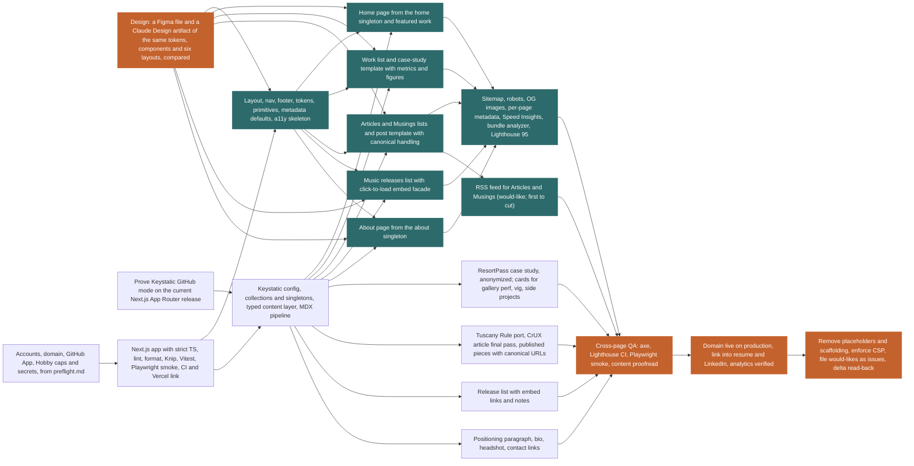

# Plan report: davidfleming.me portfolio site

Recorded 2026-11-06. Durations are working days; a week is 5.

## Checks

- The lead's own time is 2.1 weeks at 30 hours a week, over the appetite of 2 weeks. Cut units, give owned units to other people, or raise the hours.

## Units

| Unit | Kind | C | U | Depends on | o / m / p | Expected | Start | Finish | Float | On path | Route |
| --- | --- | --- | --- | --- | --- | --- | --- | --- | --- | --- | --- |
| `preflight` | preflight | 1 | 2 | none | 0.25 / 0.5 / 1 days | 0.5 | 0.0 | 0.5 | 0.5 | no | human only |
| `design` | build | 2 | 2 | none | 0.75 / 1.5 / 2.5 days | 1.5 | 0.0 | 1.5 | -0.0 | yes | human only |
| `keystatic-spike` | spike | 1 | 3 | none | 0.25 / 0.5 / 1 days | 0.5 | 0.0 | 0.5 | 1.0 | no | human only |
| `scaffold` | build | 2 | 1 | preflight | 0.25 / 0.5 / 1 days | 0.5 | 0.5 | 1.1 | 0.5 | no | human-led |
| `shell` | build | 2 | 1 | scaffold, design | 1 / 2 / 4 rounds, 60 min | 1.1 + 0.5 | 1.5 | 3.1 | -0.0 | yes | agent fan-out |
| `cms` | build | 2 | 2 | scaffold, keystatic-spike | 0.5 / 1 / 2 days | 1.1 + 0.5 | 1.1 | 2.7 | 0.5 | no | human-led |
| `page-home` | build | 1 | 1 | shell, cms, design | 1 / 1 / 2 rounds, 20 min | 0.6 + 0.5 | 3.1 | 4.2 | 0.5 | no | agent fan-out |
| `page-work` | build | 2 | 1 | shell, cms, design | 1 / 2 / 4 rounds, 60 min | 1.1 + 0.5 | 3.1 | 4.7 | -0.0 | yes | agent fan-out |
| `page-writing` | build | 2 | 1 | shell, cms, design | 1 / 2 / 4 rounds, 45 min | 1.1 + 0.5 | 3.1 | 4.7 | -0.0 | yes | agent fan-out |
| `page-music` | build | 2 | 1 | shell, cms, design | 1 / 2 / 3 rounds, 45 min | 1.0 + 0.5 | 3.1 | 4.6 | 0.1 | no | agent fan-out |
| `page-about` | build | 1 | 1 | shell, cms, design | 1 / 1 / 2 rounds, 15 min | 0.6 + 0.5 | 3.1 | 4.2 | 0.5 | no | agent fan-out |
| `content-work` | build | 1 | 2 | cms | 0.5 / 1 / 2 days | 1.1 | 2.7 | 3.8 | 2.5 | no | human only |
| `content-writing` | build | 1 | 1 | cms | 0.25 / 0.5 / 1 days | 0.5 | 2.7 | 3.2 | 3.0 | no | human only |
| `content-music` | build | 1 | 2 | cms | 0.25 / 0.5 / 1 days | 0.5 | 2.7 | 3.2 | 3.0 | no | human only |
| `content-home-about` | build | 1 | 1 | cms | 0.1 / 0.25 / 0.5 days | 0.3 | 2.7 | 2.9 | 3.3 | no | human only |
| `seo-perf` | build | 1 | 1 | page-home, page-work, page-writing, page-music, page-about | 1 / 2 / 3 rounds, 30 min | 1.0 + 0.5 | 4.7 | 6.2 | -0.0 | yes | agent fan-out |
| `feed` | build | 1 | 1 | page-writing | 1 / 1 / 2 rounds, 15 min | 0.6 | 4.7 | 5.3 | 0.9 | no | agent fan-out |
| `qa-pass` | qa | 1 | 2 | seo-perf, feed, content-work, content-writing, content-music, content-home-about | 0.5 / 0.75 / 1.5 days | 0.8 + 0.5 | 6.2 | 7.5 | -0.0 | yes | human-led |
| `launch` | launch | 1 | 1 | qa-pass | 0.25 / 0.5 / 1 days | 0.5 | 7.5 | 8.1 | -0.0 | yes | human-led |
| `tail` | tail | 1 | 1 | launch | 0.25 / 0.5 / 1 days | 0.5 | 8.1 | 8.6 | 0.0 | yes | human-led |

## Critical path

`design -> shell -> page-work -> seo-perf -> qa-pass -> launch -> tail`

Expected 8.6 days (1.7 weeks). Range 7.5 to 9.7 days (1.5 to 1.9 weeks) at two standard deviations, which assumes the unit estimates are independent.
Every unit at its optimistic figure: 5.3 days. Every unit at its pessimistic figure: 13.5 days.
A join buffer of 0.5 days is added to each unit with two or more dependencies.

## Off the path

| Unit | Float (days) | Route |
| --- | --- | --- |
| `preflight` | 0.5 | human only |
| `keystatic-spike` | 1.0 | human only |
| `scaffold` | 0.5 | human-led |
| `cms` | 0.5 | human-led |
| `page-home` | 0.5 | agent fan-out |
| `page-music` | 0.1 | agent fan-out |
| `page-about` | 0.5 | agent fan-out |
| `content-work` | 2.5 | human only |
| `content-writing` | 3.0 | human only |
| `content-music` | 3.0 | human only |
| `content-home-about` | 3.3 | human only |
| `feed` | 0.9 | agent fan-out |

## Execution model

| Route | Units | Days |
| --- | --- | --- |
| human only | `preflight`, `design`, `keystatic-spike`, `content-work`, `content-writing`, `content-music`, `content-home-about` | 5.1 |
| human-led | `scaffold`, `cms`, `qa-pass`, `launch`, `tail` | 4.5 |
| agent fan-out | `shell`, `page-home`, `page-work`, `page-writing`, `page-music`, `page-about`, `seo-perf`, `feed` | 10.5 |

- `scaffold` is declared human-led; its scores and path position give agent fan-out.
- `shell` is declared agent fan-out; its scores and path position give human-led.
- `page-work` is declared agent fan-out; its scores and path position give human-led.
- `page-writing` is declared agent fan-out; its scores and path position give human-led.
- `seo-perf` is declared agent fan-out; its scores and path position give human-led.

## Staffing

| Staffing | Duration | What binds it |
| --- | --- | --- |
| 1 engineer, no fan-out | 4.0 weeks (20.1 days) | Everything runs serially |
| 1 engineer + agent fan-out | 2.2 weeks (11.0 days) | Engineer capacity: owned units and review of agent work |
| 2 engineers + agent fan-out | 1.7 weeks (8.7 days) | Engineer capacity: owned units and review of agent work |
| 3 engineers + agent fan-out | 1.8 weeks (8.9 days) | Engineer capacity: owned units and review of agent work |
| 4 engineers + agent fan-out | 1.7 weeks (8.6 days) | The critical path: this is the floor |
| 5 engineers + agent fan-out | 1.7 weeks (8.6 days) | No further gain: the path is saturated |

Agent-built units estimated in rounds take 0.5 days a round, and an engineer for their owner minutes at the end, at 6 focus hours a day. The no-fan-out row prices them at that agent time, so it understates a team working without agents.

## Owner time

The plan needs 62 hours of a person's time: 58 on units a person owns, at 6 focus hours a day, and 5 on agent-built units.
At 30 hours a week from one lead, that is 2.1 weeks, against a floor of 1.7 weeks.
The lead's hours, not the graph, set the date, unless other people take owned units.
Rounds per unit, owner minutes, owner hours a week and the review fraction are assumptions until the delta log measures them after the third agent-built merge.

## Appetite and first milestone

Appetite: 2 weeks. Floor 1.7 weeks; the lead's own time 2.1 weeks. The plan does not fit: cut or park units before the build starts.
Home, the Work list and the ResortPass case study live at davidfleming.me: 9 units with their prerequisites (`preflight`, `design`, `keystatic-spike`, `scaffold`, `shell`, `cms`, `page-home`, `page-work`, `content-work`). Floor 0.9 weeks; the lead's own time 1.2 weeks at 30 hours a week.

## Cross-check

Serial total: 20.1 days over 20 units, 1.0 days per unit.
- Ramble demo marketplace, Oct 20 to Nov 4 2026: the 36 units with a recorded actual (summed likely estimate 68.75 days): 0.5 days per unit predicts 10.9 days. This plan is 1.84 times that.

## The sentence

> Critical path is Design: a Figma file and a Claude Design artifact of the same tokens, components and six layouts, compared, Layout, nav, footer, tokens, primitives, metadata defaults, a11y skeleton, Work list and case-study template with metrics and figures, Sitemap, robots, OG images, per-page metadata, Speed Insights, bundle analyzer, Lighthouse 95, Cross-page QA: axe, Lighthouse CI, Playwright smoke, content proofread, Domain live on production, link into resume and LinkedIn, analytics verified and Remove placeholders and scaffolding, enforce CSP, file would-likes as issues, delta read-back: about 1.7 weeks, range 1.5 to 1.9. Accounts, domain, GitHub App, Hobby caps and secrets, from preflight.md, Prove Keystatic GitHub mode on the current Next.js App Router release, Next.js app with strict TS, lint, format, Knip, Vitest, Playwright smoke, CI and Vercel link, Keystatic config, collections and singletons, typed content layer, MDX pipeline, Home page from the home singleton and featured work, Music releases list with click-to-load embed facade, About page from the about singleton, ResortPass case study, anonymized; cards for gallery perf, vig, side projects, Tuscany Rule port, CrUX article final pass, published pieces with canonical URLs, Release list with embed links and notes, Positioning paragraph, bio, headshot, contact links and RSS feed for Articles and Musings (would-like; first to cut) are off it. One engineer with no fan-out is 4.0 weeks serial. The floor is 1.7 weeks, reached with 4 engineers + agent fan-out; more people add nothing. At 30 hours a week, the lead's own time is 2.1 weeks. The first walkable milestone, Home, the Work list and the ResortPass case study live at davidfleming.me, has a floor of 0.9 weeks.

## Graph

