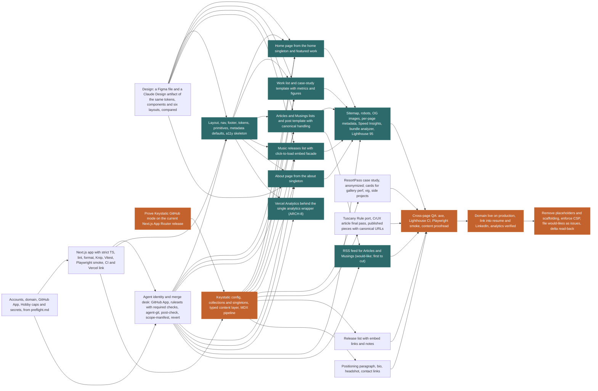

# Plan report: davidfleming.me portfolio site

Recorded 2026-11-06. Durations are working days; a week is 5.

## Checks

- No warnings.

## Units

| Unit | Kind | C | U | Depends on | o / m / p | Expected | Start | Finish | Float | On path | Route |
| --- | --- | --- | --- | --- | --- | --- | --- | --- | --- | --- | --- |
| `preflight` | build | 1 | 2 | none | 0.1 / 0.1 / 0.1 | 0.1 | 0.0 | 0.1 | 0.1 | no | human-led |
| `design` | build | 2 | 2 | none | 0.2 / 0.2 / 0.2 | 0.2 | 0.0 | 0.2 | 0.8 | no | human only |
| `keystatic-spike` | spike | 1 | 3 | none | 0.25 / 0.5 / 1 | 0.5 | 0.0 | 0.5 | 0.0 | yes | human only |
| `scaffold` | build | 2 | 1 | preflight | 0.2 / 0.2 / 0.2 | 0.2 | 0.1 | 0.3 | 0.1 | no | human-led |
| `merge-desk` | build | 2 | 2 | preflight, scaffold | 0.1 / 0.1 / 0.1 | 0.1 + 0.5 | 0.3 | 0.9 | 0.1 | no | human-led |
| `shell` | build | 2 | 1 | scaffold, design, merge-desk | 0.5 / 0.5 / 0.5 | 0.5 + 0.5 | 0.9 | 1.9 | 0.1 | no | agent fan-out |
| `cms` | build | 2 | 2 | scaffold, keystatic-spike | 1 / 1 / 1 | 1.0 + 0.5 | 0.5 | 2.0 | 0.0 | yes | human-led |
| `page-home` | build | 1 | 1 | shell, cms, design, merge-desk | 0.1 / 0.1 / 0.1 | 0.1 + 0.5 | 2.0 | 2.6 | 0.1 | no | agent fan-out |
| `page-work` | build | 2 | 1 | shell, cms, design, merge-desk | 0.2 / 0.2 / 0.2 | 0.2 + 0.5 | 2.0 | 2.7 | 0.0 | yes | agent fan-out |
| `page-writing` | build | 2 | 1 | shell, cms, design, merge-desk | 0.2 / 0.2 / 0.2 | 0.2 + 0.5 | 2.0 | 2.7 | 0.0 | yes | agent fan-out |
| `page-music` | build | 2 | 1 | shell, cms, design, merge-desk | 0.1 / 0.1 / 0.1 | 0.1 + 0.5 | 2.0 | 2.6 | 0.1 | no | agent fan-out |
| `page-about` | build | 1 | 1 | shell, cms, design, merge-desk | 0.1 / 0.1 / 0.1 | 0.1 + 0.5 | 2.0 | 2.6 | 0.1 | no | agent fan-out |
| `content-work` | build | 1 | 2 | cms | 0.5 / 1 / 2 | 1.1 | 2.0 | 3.1 | 0.3 | no | human only |
| `content-writing` | build | 1 | 1 | cms | 0.25 / 0.5 / 1 | 0.5 | 2.0 | 2.6 | 0.9 | no | human only |
| `content-music` | build | 1 | 2 | cms | 0.25 / 0.5 / 1 | 0.5 | 2.0 | 2.6 | 0.9 | no | human only |
| `content-home-about` | build | 1 | 1 | cms | 0.1 / 0.25 / 0.5 | 0.3 | 2.0 | 2.3 | 1.1 | no | human only |
| `analytics` | build | 1 | 1 | shell, merge-desk | 0.1 / 0.1 / 0.2 | 0.1 + 0.5 | 1.9 | 2.5 | 3.3 | no | agent fan-out |
| `seo-perf` | build | 1 | 1 | page-home, page-work, page-writing, page-music, page-about, merge-desk | 0.1 / 0.2 / 0.3 | 0.2 + 0.5 | 2.7 | 3.4 | 0.0 | yes | agent fan-out |
| `feed` | build | 1 | 1 | page-writing, merge-desk | 0.1 / 0.1 / 0.2 | 0.1 + 0.5 | 2.7 | 3.4 | 0.1 | no | agent fan-out |
| `qa-pass` | qa | 1 | 2 | seo-perf, feed, content-work, content-writing, content-music, content-home-about | 0.5 / 0.75 / 1.5 | 0.8 + 0.5 | 3.4 | 4.8 | 0.0 | yes | human-led |
| `launch` | launch | 1 | 1 | qa-pass | 0.25 / 0.5 / 1 | 0.5 | 4.8 | 5.3 | 0.0 | yes | human-led |
| `tail` | tail | 1 | 1 | launch | 0.25 / 0.5 / 1 | 0.5 | 5.3 | 5.9 | 0.0 | yes | human-led |

## Critical path

`keystatic-spike -> cms -> page-work -> seo-perf -> qa-pass -> launch -> tail`

Expected 5.9 days (1.2 weeks). Range 5.3 to 6.4 days (1.1 to 1.3 weeks) at two standard deviations, which assumes the unit estimates are independent.
Every unit at its optimistic figure: 4.6 days. Every unit at its pessimistic figure: 8.0 days.
A join buffer of 0.5 days is added to each unit with two or more dependencies.

## Off the path

| Unit | Float (days) | Route |
| --- | --- | --- |
| `preflight` | 0.1 | human-led |
| `design` | 0.8 | human only |
| `scaffold` | 0.1 | human-led |
| `merge-desk` | 0.1 | human-led |
| `shell` | 0.1 | agent fan-out |
| `page-home` | 0.1 | agent fan-out |
| `page-music` | 0.1 | agent fan-out |
| `page-about` | 0.1 | agent fan-out |
| `content-work` | 0.3 | human only |
| `content-writing` | 0.9 | human only |
| `content-music` | 0.9 | human only |
| `content-home-about` | 1.1 | human only |
| `analytics` | 3.3 | agent fan-out |
| `feed` | 0.1 | agent fan-out |

## Execution model

| Route | Units | Days |
| --- | --- | --- |
| human only | `design`, `keystatic-spike`, `content-work`, `content-writing`, `content-music`, `content-home-about` | 3.2 |
| human-led | `preflight`, `scaffold`, `merge-desk`, `cms`, `qa-pass`, `launch`, `tail` | 4.8 |
| agent fan-out | `shell`, `page-home`, `page-work`, `page-writing`, `page-music`, `page-about`, `analytics`, `seo-perf`, `feed` | 6.1 |

- `scaffold` is declared human-led; its scores and path position give agent fan-out.
- `page-work` is declared agent fan-out; its scores and path position give human-led.
- `page-writing` is declared agent fan-out; its scores and path position give human-led.
- `seo-perf` is declared agent fan-out; its scores and path position give human-led.

## Staffing

| Staffing | Duration | What binds it |
| --- | --- | --- |
| 1 engineer, no fan-out | 2.8 weeks (14.1 days) | Everything runs serially |
| 2 engineers | 1.6 weeks (8.0 days) | Engineer capacity |
| 3 engineers | 1.4 weeks (7.0 days) | Engineer capacity |
| 4 engineers | 1.3 weeks (6.4 days) | Engineer capacity |
| 5 engineers | 1.2 weeks (6.2 days) | Engineer capacity |
| 6 engineers | 1.2 weeks (6.0 days) | Engineer capacity |

Fan-out rows are left out: `assumptions.agent_review_fraction` is not set.

## Cross-check

Serial total: 14.1 days over 22 units, 0.6 days per unit.
- Ramble demo marketplace, Oct 20 to Nov 4 2026: the 36 units with a recorded actual (summed likely estimate 68.75 days): 0.5 days per unit predicts 12.0 days. This plan is 1.18 times that.

## The sentence

> Critical path is Prove Keystatic GitHub mode on the current Next.js App Router release, Keystatic config, collections and singletons, typed content layer, MDX pipeline, Work list and case-study template with metrics and figures, Sitemap, robots, OG images, per-page metadata, Speed Insights, bundle analyzer, Lighthouse 95, Cross-page QA: axe, Lighthouse CI, Playwright smoke, content proofread, Domain live on production, link into resume and LinkedIn, analytics verified and Remove placeholders and scaffolding, enforce CSP, file would-likes as issues, delta read-back: about 1.2 weeks, range 1.1 to 1.3. Accounts, domain, GitHub App, Hobby caps and secrets, from preflight.md, Design: a Figma file and a Claude Design artifact of the same tokens, components and six layouts, compared, Next.js app with strict TS, lint, format, Knip, Vitest, Playwright smoke, CI and Vercel link, Agent identity and merge desk: GitHub App, rulesets with required checks, agent-git, post-check, scope-manifest, revert, Layout, nav, footer, tokens, primitives, metadata defaults, a11y skeleton, Home page from the home singleton and featured work, Music releases list with click-to-load embed facade, About page from the about singleton, ResortPass case study, anonymized; cards for gallery perf, vig, side projects, Tuscany Rule port, CrUX article final pass, published pieces with canonical URLs, Release list with embed links and notes, Positioning paragraph, bio, headshot, contact links, Vercel Analytics behind the single analytics wrapper (ARCH-8) and RSS feed for Articles and Musings (would-like; first to cut) are off it. One engineer with no fan-out is 2.8 weeks serial.

## Graph

